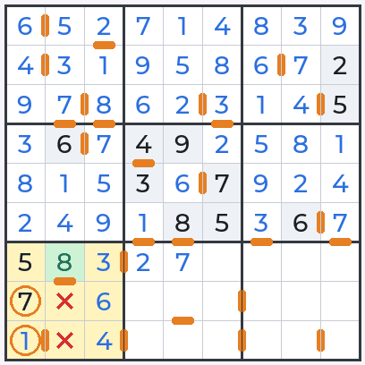

<!-- Written by tools/walkthrough.py consecutive: edit the script, not this page. -->
# Consecutive, step 51: the 8 in box 7

**Step 51 of 69** · [← Step 50](step-50.md) · [All steps](../consecutive.md#the-whole-puzzle-step-by-step) · [Step 52 →](step-52.md)

Box 7 needs an 8. r8c2: it has no bar to the 7 in r8c1, so it isn't 6 or 8. r9c2: it has a bar to the 1 in r9c1, so it's 2. Only **r7c2** is left: **r7c2 = 8**.

**Step 51 of 69** · [← Step 50](step-50.md) · [All steps](../consecutive.md#the-whole-puzzle-step-by-step) · [Step 52 →](step-52.md)
