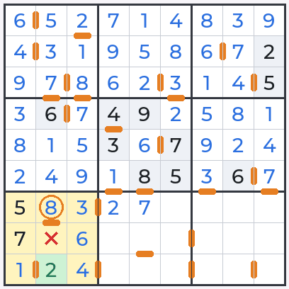

<!-- Written by tools/walkthrough.py consecutive: edit the script, not this page. -->
# Consecutive, step 52: the 2 in box 7

**Step 52 of 69** · [← Step 51](step-51.md) · [All steps](../consecutive.md#the-whole-puzzle-step-by-step) · [Step 53 →](step-53.md)

Box 7 needs a 2. r8c2: it has a bar to the 8 in r7c2, so it's 7 or 9. Only **r9c2** is left: **r9c2 = 2**.

**Step 52 of 69** · [← Step 51](step-51.md) · [All steps](../consecutive.md#the-whole-puzzle-step-by-step) · [Step 53 →](step-53.md)
