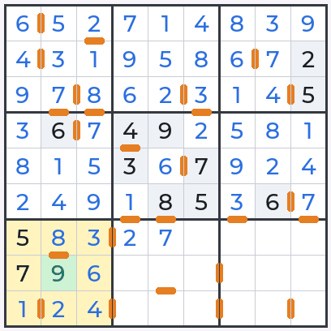

<!-- Written by tools/walkthrough.py consecutive: edit the script, not this page. -->
# Consecutive, step 53: the 9 in box 7

**Step 53 of 69** · [← Step 52](step-52.md) · [All steps](../consecutive.md#the-whole-puzzle-step-by-step) · [Step 54 →](step-54.md)

Box 7 needs a 9, and r8c2 is its last empty cell: **r8c2 = 9**.

**Step 53 of 69** · [← Step 52](step-52.md) · [All steps](../consecutive.md#the-whole-puzzle-step-by-step) · [Step 54 →](step-54.md)
