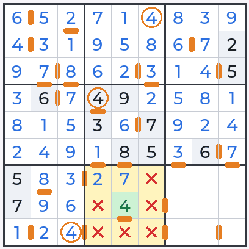

<!-- Written by tools/walkthrough.py consecutive: edit the script, not this page. -->
# Consecutive, step 54: the 4 in box 8

**Step 54 of 69** · [← Step 53](step-53.md) · [All steps](../consecutive.md#the-whole-puzzle-step-by-step) · [Step 55 →](step-55.md)

Box 8 needs a 4. r7c6 and r8c6: column 6 has one (r1c6). r8c4: column 4 has one (r4c4). r9c4, r9c5 and r9c6: row 9 has one (r9c3). Only **r8c5** is left: **r8c5 = 4**.

**Step 54 of 69** · [← Step 53](step-53.md) · [All steps](../consecutive.md#the-whole-puzzle-step-by-step) · [Step 55 →](step-55.md)
