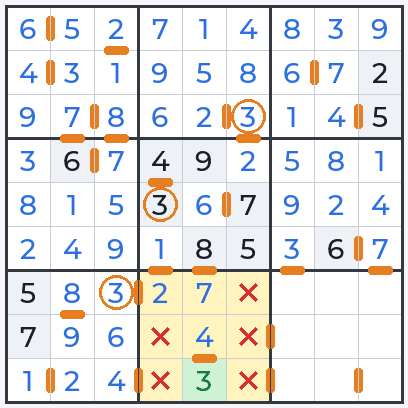

<!-- Written by tools/walkthrough.py consecutive: edit the script, not this page. -->
# Consecutive, step 55: the 3 in box 8

**Step 55 of 69** · [← Step 54](step-54.md) · [All steps](../consecutive.md#the-whole-puzzle-step-by-step) · [Step 56 →](step-56.md)

Box 8 needs a 3. r7c6: row 7 has one (r7c3). r8c4 and r9c4: column 4 has one (r5c4). r8c6 and r9c6: column 6 has one (r3c6). Only **r9c5** is left: **r9c5 = 3**.

**Step 55 of 69** · [← Step 54](step-54.md) · [All steps](../consecutive.md#the-whole-puzzle-step-by-step) · [Step 56 →](step-56.md)
