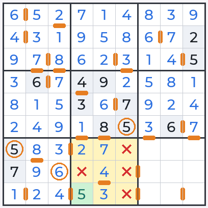

<!-- Written by tools/walkthrough.py consecutive: edit the script, not this page. -->
# Consecutive, step 56: the 5 in box 8

**Step 56 of 69** · [← Step 55](step-55.md) · [All steps](../consecutive.md#the-whole-puzzle-step-by-step) · [Step 57 →](step-57.md)

Box 8 needs a 5. r7c6: row 7 has one (r7c1). r8c6 and r9c6: column 6 has one (r6c6). r8c4: it has no bar to the 6 in r8c3, so it isn't 5 or 7. Only **r9c4** is left: **r9c4 = 5**.

**Step 56 of 69** · [← Step 55](step-55.md) · [All steps](../consecutive.md#the-whole-puzzle-step-by-step) · [Step 57 →](step-57.md)
