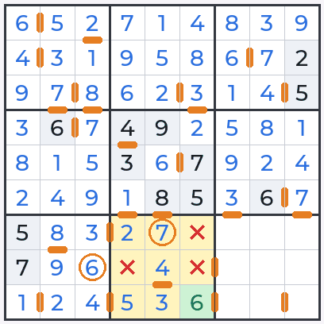

<!-- Written by tools/walkthrough.py consecutive: edit the script, not this page. -->
# Consecutive, step 57: the 6 in box 8

**Step 57 of 69** · [← Step 56](step-56.md) · [All steps](../consecutive.md#the-whole-puzzle-step-by-step) · [Step 58 →](step-58.md)

Box 8 needs a 6. r8c4 and r8c6: row 8 has one (r8c3). r7c6: it has no bar to the 7 in r7c5, so it isn't 6 or 8. Only **r9c6** is left: **r9c6 = 6**.

**Step 57 of 69** · [← Step 56](step-56.md) · [All steps](../consecutive.md#the-whole-puzzle-step-by-step) · [Step 58 →](step-58.md)
