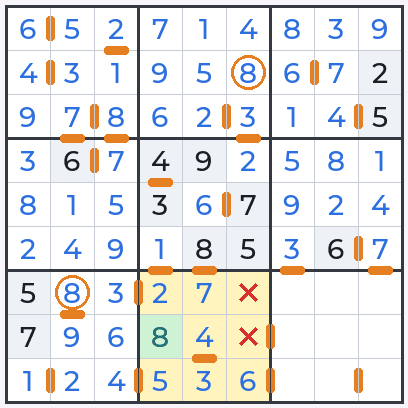

<!-- Written by tools/walkthrough.py consecutive: edit the script, not this page. -->
# Consecutive, step 58: the 8 in box 8

**Step 58 of 69** · [← Step 57](step-57.md) · [All steps](../consecutive.md#the-whole-puzzle-step-by-step) · [Step 59 →](step-59.md)

Box 8 needs an 8. r7c6: row 7 has one (r7c2). r8c6: column 6 has one (r2c6). Only **r8c4** is left: **r8c4 = 8**.

**Step 58 of 69** · [← Step 57](step-57.md) · [All steps](../consecutive.md#the-whole-puzzle-step-by-step) · [Step 59 →](step-59.md)
