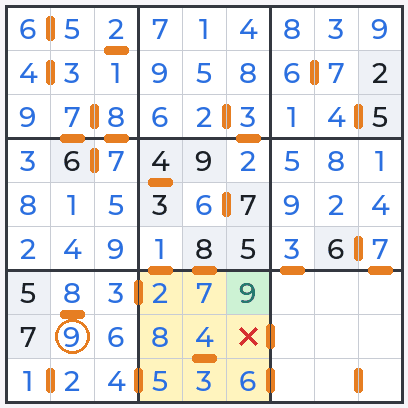

<!-- Written by tools/walkthrough.py consecutive: edit the script, not this page. -->
# Consecutive, step 59: the 9 in box 8

**Step 59 of 69** · [← Step 58](step-58.md) · [All steps](../consecutive.md#the-whole-puzzle-step-by-step) · [Step 60 →](step-60.md)

Box 8 needs a 9. r8c6: row 8 has one (r8c2). Only **r7c6** is left: **r7c6 = 9**.

**Step 59 of 69** · [← Step 58](step-58.md) · [All steps](../consecutive.md#the-whole-puzzle-step-by-step) · [Step 60 →](step-60.md)
