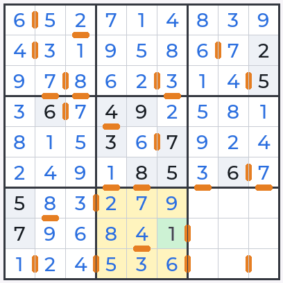

<!-- Written by tools/walkthrough.py consecutive: edit the script, not this page. -->
# Consecutive, step 60: the 1 in box 8

**Step 60 of 69** · [← Step 59](step-59.md) · [All steps](../consecutive.md#the-whole-puzzle-step-by-step) · [Step 61 →](step-61.md)

Box 8 needs a 1, and r8c6 is its last empty cell: **r8c6 = 1**.

**Step 60 of 69** · [← Step 59](step-59.md) · [All steps](../consecutive.md#the-whole-puzzle-step-by-step) · [Step 61 →](step-61.md)
