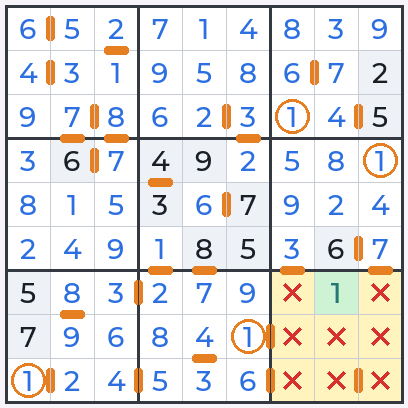

<!-- Written by tools/walkthrough.py consecutive: edit the script, not this page. -->
# Consecutive, step 61: the 1 in box 9

**Step 61 of 69** · [← Step 60](step-60.md) · [All steps](../consecutive.md#the-whole-puzzle-step-by-step) · [Step 62 →](step-62.md)

Box 9 needs a 1. r7c7: column 7 has one (r3c7). r7c9: column 9 has one (r4c9). r8c7, r8c8 and r8c9: row 8 has one (r8c6). r9c7, r9c8 and r9c9: row 9 has one (r9c1). Only **r7c8** is left: **r7c8 = 1**.

**Step 61 of 69** · [← Step 60](step-60.md) · [All steps](../consecutive.md#the-whole-puzzle-step-by-step) · [Step 62 →](step-62.md)
