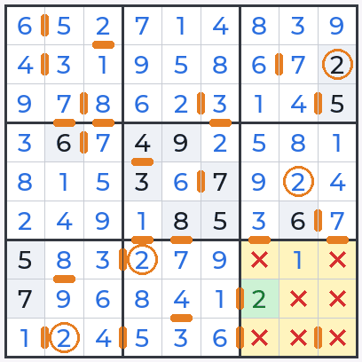

<!-- Written by tools/walkthrough.py consecutive: edit the script, not this page. -->
# Consecutive, step 62: the 2 in box 9

**Step 62 of 69** · [← Step 61](step-61.md) · [All steps](../consecutive.md#the-whole-puzzle-step-by-step) · [Step 63 →](step-63.md)

Box 9 needs a 2. r7c7 and r7c9: row 7 has one (r7c4). r8c8: column 8 has one (r5c8). r8c9: column 9 has one (r2c9). r9c7, r9c8 and r9c9: row 9 has one (r9c2). Only **r8c7** is left: **r8c7 = 2**.

**Step 62 of 69** · [← Step 61](step-61.md) · [All steps](../consecutive.md#the-whole-puzzle-step-by-step) · [Step 63 →](step-63.md)
