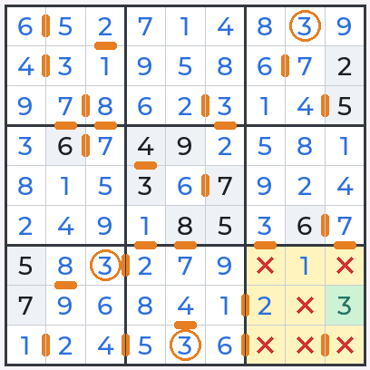

<!-- Written by tools/walkthrough.py consecutive: edit the script, not this page. -->
# Consecutive, step 63: the 3 in box 9

**Step 63 of 69** · [← Step 62](step-62.md) · [All steps](../consecutive.md#the-whole-puzzle-step-by-step) · [Step 64 →](step-64.md)

Box 9 needs a 3. r7c7 and r7c9: row 7 has one (r7c3). r8c8: column 8 has one (r1c8). r9c7, r9c8 and r9c9: row 9 has one (r9c5). Only **r8c9** is left: **r8c9 = 3**.

**Step 63 of 69** · [← Step 62](step-62.md) · [All steps](../consecutive.md#the-whole-puzzle-step-by-step) · [Step 64 →](step-64.md)
