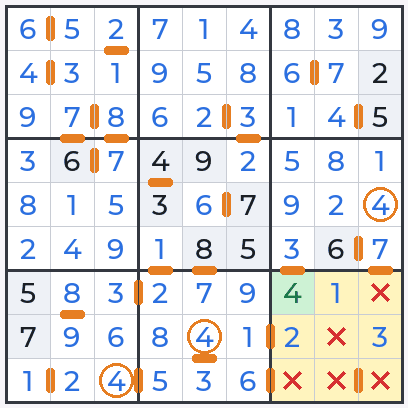

<!-- Written by tools/walkthrough.py consecutive: edit the script, not this page. -->
# Consecutive, step 64: the 4 in box 9

**Step 64 of 69** · [← Step 63](step-63.md) · [All steps](../consecutive.md#the-whole-puzzle-step-by-step) · [Step 65 →](step-65.md)

Box 9 needs a 4. r7c9: column 9 has one (r5c9). r8c8: row 8 has one (r8c5). r9c7, r9c8 and r9c9: row 9 has one (r9c3). Only **r7c7** is left: **r7c7 = 4**.

**Step 64 of 69** · [← Step 63](step-63.md) · [All steps](../consecutive.md#the-whole-puzzle-step-by-step) · [Step 65 →](step-65.md)
