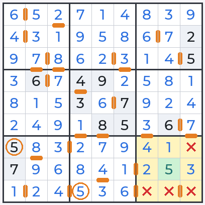

<!-- Written by tools/walkthrough.py consecutive: edit the script, not this page. -->
# Consecutive, step 65: the 5 in box 9

**Step 65 of 69** · [← Step 64](step-64.md) · [All steps](../consecutive.md#the-whole-puzzle-step-by-step) · [Step 66 →](step-66.md)

Box 9 needs a 5. r7c9: row 7 has one (r7c1). r9c7, r9c8 and r9c9: row 9 has one (r9c4). Only **r8c8** is left: **r8c8 = 5**.

**Step 65 of 69** · [← Step 64](step-64.md) · [All steps](../consecutive.md#the-whole-puzzle-step-by-step) · [Step 66 →](step-66.md)
