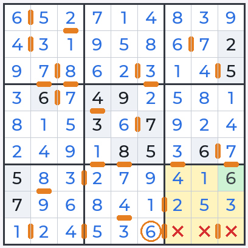

<!-- Written by tools/walkthrough.py consecutive: edit the script, not this page. -->
# Consecutive, step 66: the 6 in box 9

**Step 66 of 69** · [← Step 65](step-65.md) · [All steps](../consecutive.md#the-whole-puzzle-step-by-step) · [Step 67 →](step-67.md)

Box 9 needs a 6. r9c7, r9c8 and r9c9: row 9 has one (r9c6). Only **r7c9** is left: **r7c9 = 6**.

**Step 66 of 69** · [← Step 65](step-65.md) · [All steps](../consecutive.md#the-whole-puzzle-step-by-step) · [Step 67 →](step-67.md)
