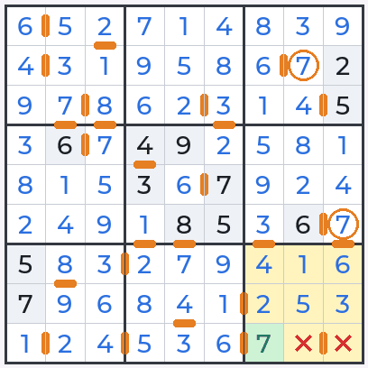

<!-- Written by tools/walkthrough.py consecutive: edit the script, not this page. -->
# Consecutive, step 67: the 7 in box 9

**Step 67 of 69** · [← Step 66](step-66.md) · [All steps](../consecutive.md#the-whole-puzzle-step-by-step) · [Step 68 →](step-68.md)

Box 9 needs a 7. r9c8: column 8 has one (r2c8). r9c9: column 9 has one (r6c9). Only **r9c7** is left: **r9c7 = 7**.

**Step 67 of 69** · [← Step 66](step-66.md) · [All steps](../consecutive.md#the-whole-puzzle-step-by-step) · [Step 68 →](step-68.md)
