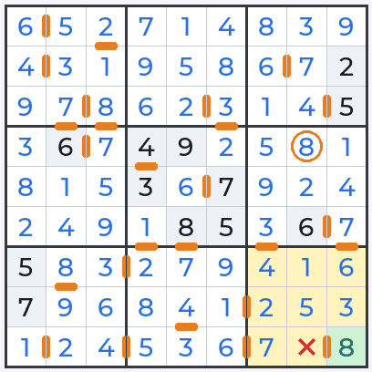

<!-- Written by tools/walkthrough.py consecutive: edit the script, not this page. -->
# Consecutive, step 68: the 8 in box 9

**Step 68 of 69** · [← Step 67](step-67.md) · [All steps](../consecutive.md#the-whole-puzzle-step-by-step) · [Step 69 →](step-69.md)

Box 9 needs an 8. r9c8: column 8 has one (r4c8). Only **r9c9** is left: **r9c9 = 8**.

**Step 68 of 69** · [← Step 67](step-67.md) · [All steps](../consecutive.md#the-whole-puzzle-step-by-step) · [Step 69 →](step-69.md)
