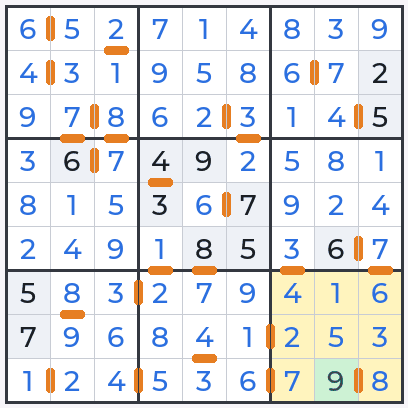

<!-- Written by tools/walkthrough.py consecutive: edit the script, not this page. -->
# Consecutive, step 69: the 9 in box 9

**Step 69 of 69** · [← Step 68](step-68.md) · [All steps](../consecutive.md#the-whole-puzzle-step-by-step) · [All steps](../consecutive.md#the-whole-puzzle-step-by-step)

Box 9 needs a 9, and r9c8 is its last empty cell: **r9c8 = 9**.

Solved.

**Step 69 of 69** · [← Step 68](step-68.md) · [All steps](../consecutive.md#the-whole-puzzle-step-by-step) · [All steps](../consecutive.md#the-whole-puzzle-step-by-step)
