# Diagonal Consecutive

[← All variants](README.md) · [Puzzles](../features-puzzles.md) · [How to play](../how-to-play.md)

## The rules

[Classic](classic.md) rules, and **marks across corners**: where two cells touch at a corner and an orange bar joins them, their digits are **1 apart** (3 and 4). Where no bar joins two corner-touching cells, they are **not** 1 apart. Every such pair is marked, so the missing marks are clues too, as in [Diagonal Non-Consecutive](diagonal-non-consecutive.md), which is this variant with no marks at all.

## On the board

- A short orange bar crosses the corner, along the diagonal of the two cells it joins; where two bars cross at one corner, both pairs are 1 apart.
- Two corner neighbours that break the rule (marked and not 1 apart, or unmarked and 1 apart) turn red.
- The grader and hints take out what each corner neighbour rules out: "The cells touching row 2, column 1 at its corners are 1 apart from it where a mark joins them, and not where none does, which leaves it only 3, 5."
- **Puzzles → ⋮ → New puzzle → Marks → Diagonal C.** The marks say so much that a Medium or Expert puzzle keeps only a handful of givens.

## How to solve it

- **A mark leaves two digits:** marked to a 4, a cell is 3 or 5; marked to a 1 it's 2, to a 9 it's 8.
- **No mark rules out two:** unmarked next to a 4, a corner cell can't be 3 or 5.
- **Two marks from one digit:** a 4 marked to two cells in the same row (or column) makes them 3 and 5, one each: the rest of that row needs its 3 and 5 nowhere else.

## Worked example

**variant-examples #49**, Diagonal Consecutive Easy (see [Classic](classic.md#worked-example-the-whole-puzzle) for how to import the examples; cells are written r*row*c*column*). The 4 in r1c2 has a mark at both its bottom corners: r2c1 and r2c3 are each 3 or 5.

**Step 1: the 1 in box 1.** r1c3 and r2c3: column 3 has a 1 (r9c3). r2c2: column 2 has one (r6c2). Row 3 has one (r3c4). And r2c1 is marked to the 4, so it's 3 or 5. Only **r1c1** is left: **r1c1 = 1**.

**Step 2: the 2 in box 1.** r2c2: column 2 has a 2 (r7c2); row 3 has one (r3c8); r2c1 and r2c3 are both marked to the 4. Only **r1c3** is left: **r1c3 = 2**.

**Step 3: the 9 in box 1.** r2c1: column 1 has a 9 (r7c1); row 3 has one (r3c9); r2c3 is marked to the 4. Only **r2c2** is left: **r2c2 = 9**.

## The whole puzzle, step by step

<!-- walkthrough -->
<!-- Written by tools/walkthrough.py diagonal-consecutive: edit the script, not this part. -->

The whole puzzle, from the start to the last cell: 57 steps, each one a single (one place left for a digit, or one digit left for a cell), taken in the order a box's single comes first, so not quite the order of the worked example above. In each picture, the unit the step looks at is tinted yellow (for a cell with one digit left: its row, column and box), the new digit is on green, the digits that rule cells out have an **orange ring**, and the empty cells they rule out a **red cross**. Givens are on grey, digits from earlier steps in blue.

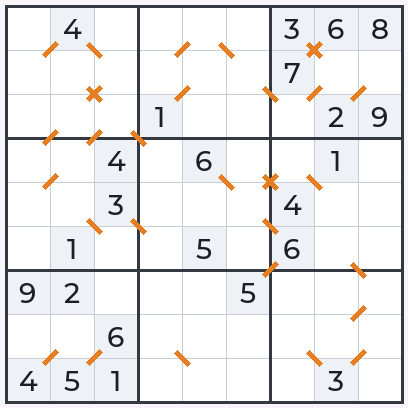

#### Step 1: the 1 in box 1

Box 1 needs a 1. r1c3 and r2c3: column 3 has one (r9c3). r2c2: column 2 has one (r6c2). r3c1, r3c2 and r3c3: row 3 has one (r3c4). r2c1: a mark joins it to the 4 in r1c2 at a corner, and 1 isn't 1 away from it. Only **r1c1** is left: **r1c1 = 1**.

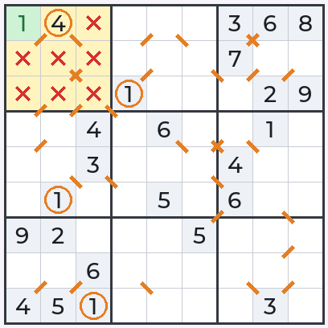

#### Step 2: the 2 in box 1

Box 1 needs a 2. r2c2: column 2 has one (r7c2). r3c1, r3c2 and r3c3: row 3 has one (r3c8). r2c1 and r2c3: a mark joins it to the 4 in r1c2 at a corner, and 2 isn't 1 away from it. Only **r1c3** is left: **r1c3 = 2**.

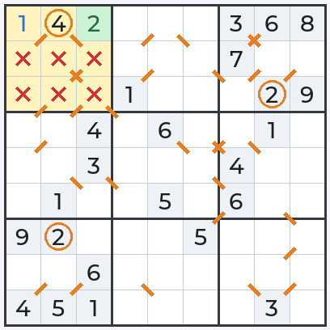

#### Step 3: the 9 in box 1

Box 1 needs a 9. r2c1: column 1 has one (r7c1). r3c1, r3c2 and r3c3: row 3 has one (r3c9). r2c3: a mark joins it to the 4 in r1c2 at a corner, and 9 isn't 1 away from it. Only **r2c2** is left: **r2c2 = 9**.

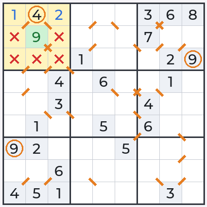

#### Step 4: the 1 in box 3

Box 3 needs a 1. r2c8: column 8 has one (r4c8). r3c7: row 3 has one (r3c4). Only **r2c9** is left: **r2c9 = 1**.

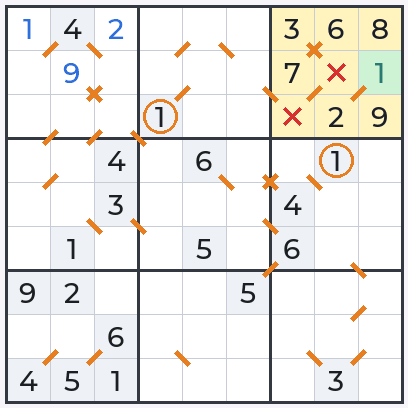

#### Step 5: the 4 in box 3

Box 3 needs a 4. r3c7: column 7 has one (r5c7). Only **r2c8** is left: **r2c8 = 4**.

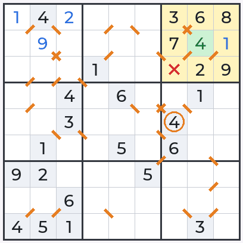

#### Step 6: the 5 in box 3

Box 3 needs a 5, and r3c7 is its last empty cell: **r3c7 = 5**.

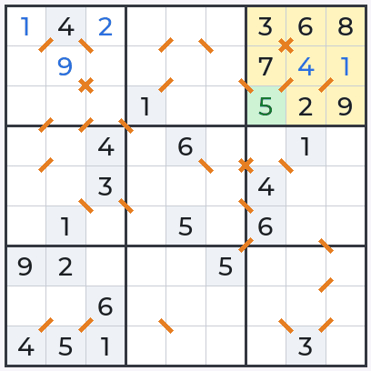

#### Step 7: the 9 in box 4

Box 4 needs a 9. r4c1, r5c1 and r6c1: column 1 has one (r7c1). r4c2 and r5c2: column 2 has one (r2c2). Only **r6c3** is left: **r6c3 = 9**.

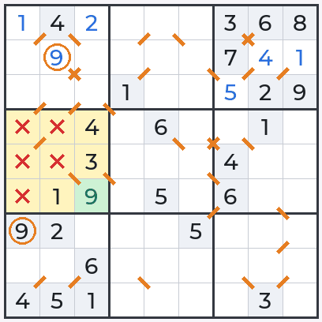

#### Step 8: the 6 in box 4

Box 4 needs a 6. r4c1 and r4c2: row 4 has one (r4c5). r6c1: row 6 has one (r6c7). r5c2: a mark joins it to the 9 in r6c3 at a corner, and 6 isn't 1 away from it. Only **r5c1** is left: **r5c1 = 6**.

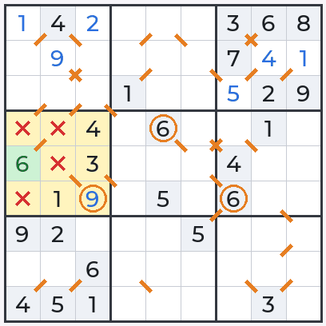

#### Step 9: the 6 in box 1

Box 1 needs a 6. r2c1 and r3c1: column 1 has one (r5c1). r2c3 and r3c3: column 3 has one (r8c3). Only **r3c2** is left: **r3c2 = 6**.

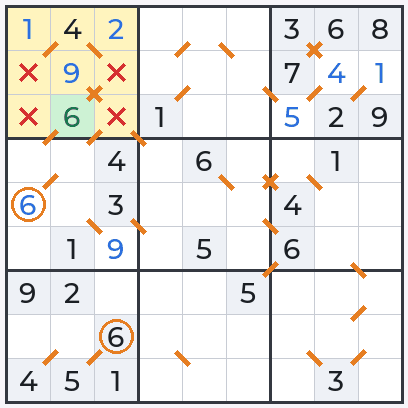

#### Step 10: the 5 in box 1

Box 1 needs a 5. r3c1 and r3c3: row 3 has one (r3c7). r2c1: it touches the 6 in r3c2 at a corner with no mark between them, and 5 is 1 away from it. Only **r2c3** is left: **r2c3 = 5**.

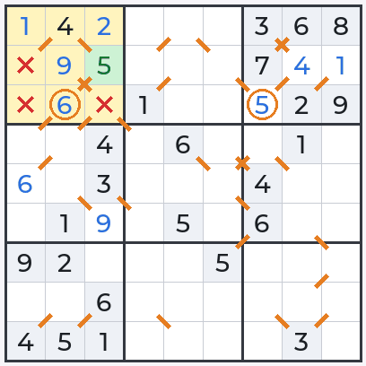

#### Step 11: the 7 in box 1

Box 1 needs a 7. r2c1: row 2 has one (r2c7). r3c3: a mark joins it to the 9 in r2c2 at a corner, and 7 isn't 1 away from it. Only **r3c1** is left: **r3c1 = 7**.

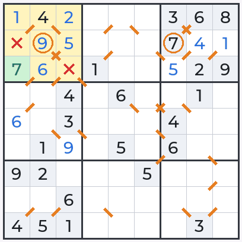

#### Step 12: the 3 in box 1

Box 1 needs a 3. r3c3: column 3 has one (r5c3). Only **r2c1** is left: **r2c1 = 3**.

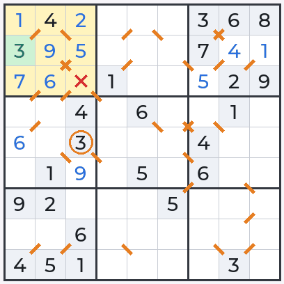

#### Step 13: the 8 in box 1

Box 1 needs an 8, and r3c3 is its last empty cell: **r3c3 = 8**.

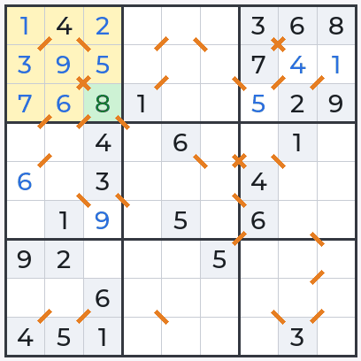

#### Step 14: the 5 in box 2

Box 2 needs a 5. r1c5: column 5 has one (r6c5). r1c6: column 6 has one (r7c6). r2c4, r2c5 and r2c6: row 2 has one (r2c3). r3c5 and r3c6: row 3 has one (r3c7). Only **r1c4** is left: **r1c4 = 5**.

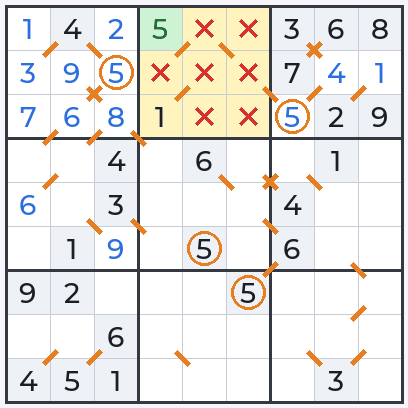

#### Step 15: the 8 in box 2

Box 2 needs an 8. r1c5 and r1c6: row 1 has one (r1c9). r3c5 and r3c6: row 3 has one (r3c3). r2c5: a mark joins it to the 1 in r3c4 at a corner, and 8 isn't 1 away from it. r2c6: a mark joins it to the 5 in r3c7 at a corner, and 8 isn't 1 away from it. Only **r2c4** is left: **r2c4 = 8**.

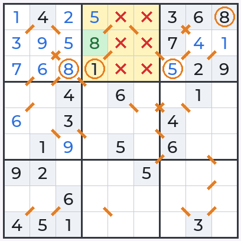

#### Step 16: the 2 in box 2

Box 2 needs a 2. r1c5 and r1c6: row 1 has one (r1c3). r3c5 and r3c6: row 3 has one (r3c8). r2c6: it touches the 3 in r1c7 at a corner with no mark between them, and 2 is 1 away from it. Only **r2c5** is left: **r2c5 = 2**.

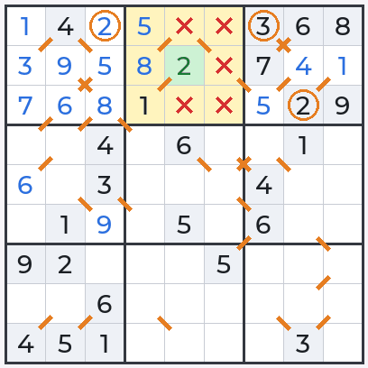

#### Step 17: the 3 in box 2

Box 2 needs a 3. r1c5 and r1c6: row 1 has one (r1c7). r2c6: row 2 has one (r2c1). r3c6: it touches the 2 in r2c5 at a corner with no mark between them, and 3 is 1 away from it. Only **r3c5** is left: **r3c5 = 3**.

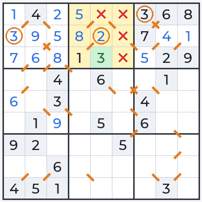

#### Step 18: the 4 in box 2

Box 2 needs a 4. r1c5 and r1c6: row 1 has one (r1c2). r2c6: row 2 has one (r2c8). Only **r3c6** is left: **r3c6 = 4**.

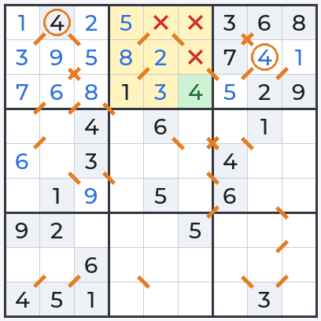

#### Step 19: the 6 in box 2

Box 2 needs a 6. r1c5 and r1c6: row 1 has one (r1c8). Only **r2c6** is left: **r2c6 = 6**.

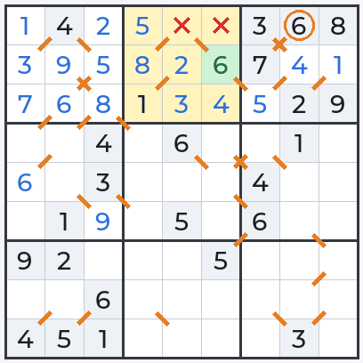

#### Step 20: the 9 in box 2

Box 2 needs a 9. r1c5: a mark joins it to the 6 in r2c6 at a corner, and 9 isn't 1 away from it. Only **r1c6** is left: **r1c6 = 9**.

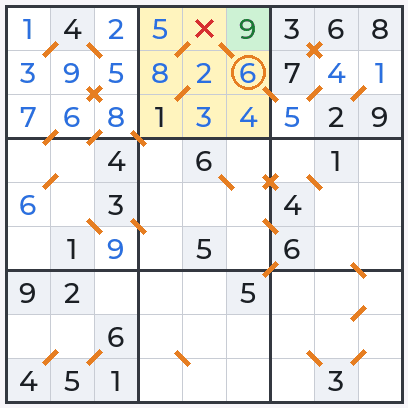

#### Step 21: the 7 in box 2

Box 2 needs a 7, and r1c5 is its last empty cell: **r1c5 = 7**.

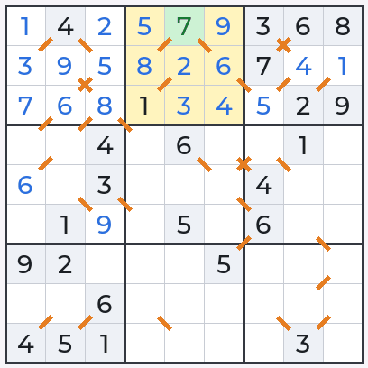

#### Step 22: the 2 in box 4

Box 4 needs a 2. r4c2 and r5c2: column 2 has one (r7c2). r4c1: a mark joins it to the 6 in r3c2 at a corner, and 2 isn't 1 away from it. Only **r6c1** is left: **r6c1 = 2**.

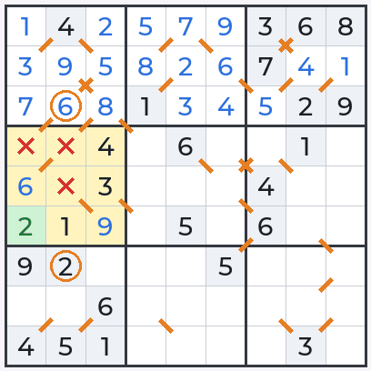

#### Step 23: the 5 in box 4

Box 4 needs a 5. r4c2 and r5c2: column 2 has one (r9c2). Only **r4c1** is left: **r4c1 = 5**.

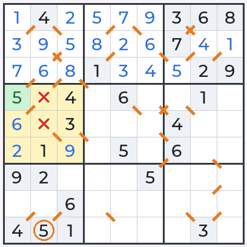

#### Step 24: the 7 in box 4

Box 4 needs a 7. r5c2: a mark joins it to the 9 in r6c3 at a corner, and 7 isn't 1 away from it. Only **r4c2** is left: **r4c2 = 7**.

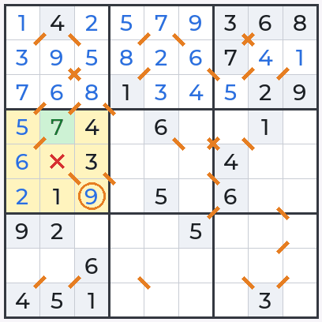

#### Step 25: the 8 in box 4

Box 4 needs an 8, and r5c2 is its last empty cell: **r5c2 = 8**.

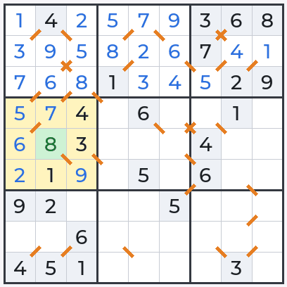

#### Step 26: the 1 in box 5

Box 5 needs a 1. r4c4 and r4c6: row 4 has one (r4c8). r5c4: column 4 has one (r3c4). r6c4 and r6c6: row 6 has one (r6c2). r5c6: a mark joins it to the 6 in r4c5 at a corner, and 1 isn't 1 away from it. Only **r5c5** is left: **r5c5 = 1**.

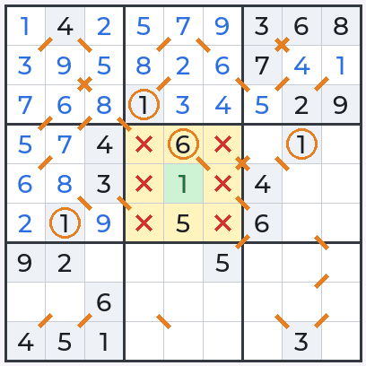

#### Step 27: the 2 in box 5

Box 5 needs a 2. r6c4 and r6c6: row 6 has one (r6c1). r4c4: a mark joins it to the 8 in r3c3 at a corner, and 2 isn't 1 away from it. r4c6: it touches the 3 in r3c5 at a corner with no mark between them, and 2 is 1 away from it. r5c6: a mark joins it to the 6 in r4c5 at a corner, and 2 isn't 1 away from it. Only **r5c4** is left: **r5c4 = 2**.

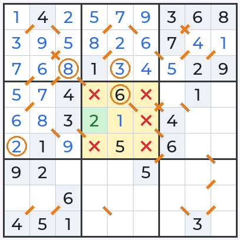

#### Step 28: the 3 in box 5

Box 5 needs a 3. r5c6: row 5 has one (r5c3). r4c4: a mark joins it to the 8 in r3c3 at a corner, and 3 isn't 1 away from it. r6c4: a mark joins it to the 3 in r5c3 at a corner, and 3 isn't 1 away from it. r6c6: it touches the 4 in r5c7 at a corner with no mark between them, and 3 is 1 away from it. Only **r4c6** is left: **r4c6 = 3**.

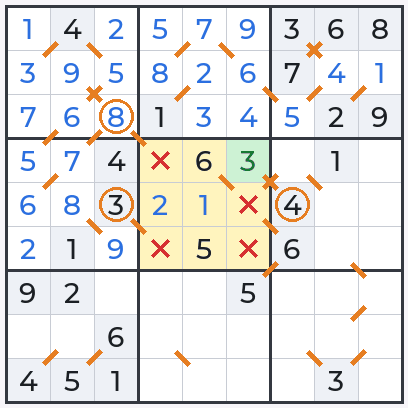

#### Step 29: the 4 in box 5

Box 5 needs a 4. r4c4: row 4 has one (r4c3). r5c6: row 5 has one (r5c7). r6c6: column 6 has one (r3c6). Only **r6c4** is left: **r6c4 = 4**.

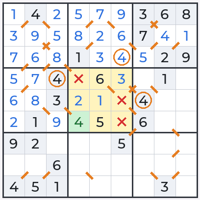

#### Step 30: the 8 in box 5

Box 5 needs an 8. r4c4: column 4 has one (r2c4). r5c6: row 5 has one (r5c2). Only **r6c6** is left: **r6c6 = 8**.

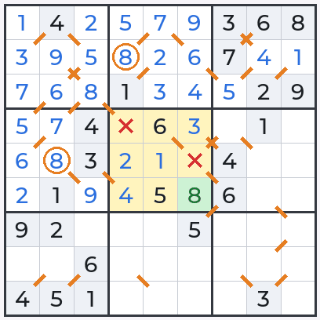

#### Step 31: the 7 in box 5

Box 5 needs a 7. r4c4: row 4 has one (r4c2). Only **r5c6** is left: **r5c6 = 7**.

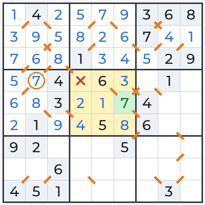

#### Step 32: the 9 in box 5

Box 5 needs a 9, and r4c4 is its last empty cell: **r4c4 = 9**.

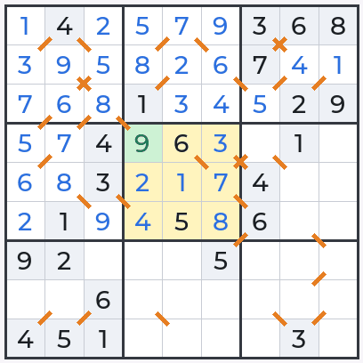

#### Step 33: the 2 in box 6

Box 6 needs a 2. r5c8 and r5c9: row 5 has one (r5c4). r6c8 and r6c9: row 6 has one (r6c1). r4c7: a mark joins it to the 7 in r5c6 at a corner, and 2 isn't 1 away from it. Only **r4c9** is left: **r4c9 = 2**.

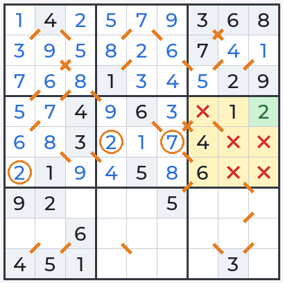

#### Step 34: the 3 in box 6

Box 6 needs a 3. r4c7: row 4 has one (r4c6). r5c8 and r5c9: row 5 has one (r5c3). r6c8: column 8 has one (r9c8). Only **r6c9** is left: **r6c9 = 3**.

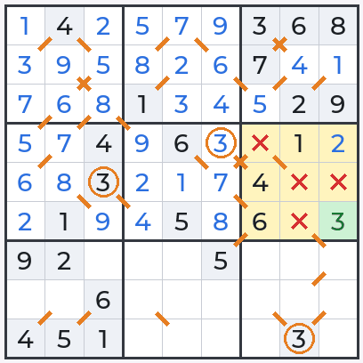

#### Step 35: the 5 in box 6

Box 6 needs a 5. r4c7: row 4 has one (r4c1). r6c8: row 6 has one (r6c5). r5c8: it touches the 6 in r6c7 at a corner with no mark between them, and 5 is 1 away from it. Only **r5c9** is left: **r5c9 = 5**.

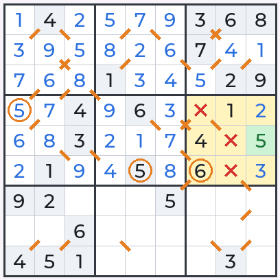

#### Step 36: the 7 in box 6

Box 6 needs a 7. r4c7: row 4 has one (r4c2). r5c8: row 5 has one (r5c6). Only **r6c8** is left: **r6c8 = 7**.

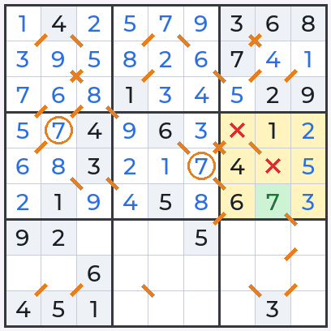

#### Step 37: the 8 in box 6

Box 6 needs an 8. r5c8: row 5 has one (r5c2). Only **r4c7** is left: **r4c7 = 8**.

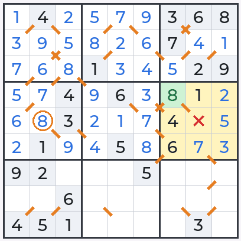

#### Step 38: the 9 in box 6

Box 6 needs a 9, and r5c8 is its last empty cell: **r5c8 = 9**.

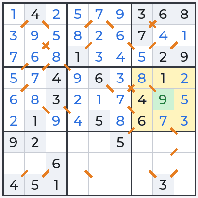

#### Step 39: the 3 in box 7

Box 7 needs a 3. r7c3: column 3 has one (r5c3). r8c1: column 1 has one (r2c1). Only **r8c2** is left: **r8c2 = 3**.

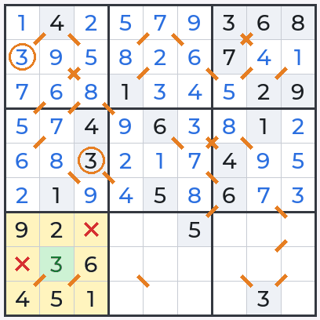

#### Step 40: the 7 in box 7

Box 7 needs a 7. r8c1: column 1 has one (r3c1). Only **r7c3** is left: **r7c3 = 7**.

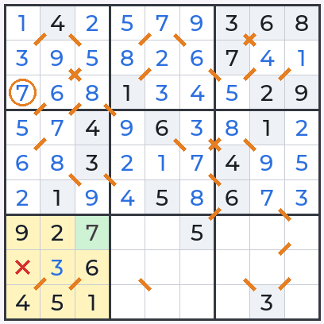

#### Step 41: the 8 in box 7

Box 7 needs an 8, and r8c1 is its last empty cell: **r8c1 = 8**.

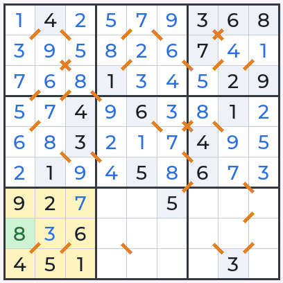

#### Step 42: the 1 in box 8

Box 8 needs a 1. r7c4 and r8c4: column 4 has one (r3c4). r7c5 and r8c5: column 5 has one (r5c5). r9c4, r9c5 and r9c6: row 9 has one (r9c3). Only **r8c6** is left: **r8c6 = 1**.

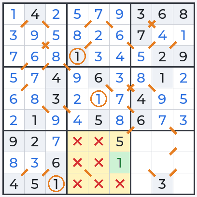

#### Step 43: the 2 in box 8

Box 8 needs a 2. r7c4 and r7c5: row 7 has one (r7c2). r8c4 and r9c4: column 4 has one (r5c4). r8c5 and r9c5: column 5 has one (r2c5). Only **r9c6** is left: **r9c6 = 2**.

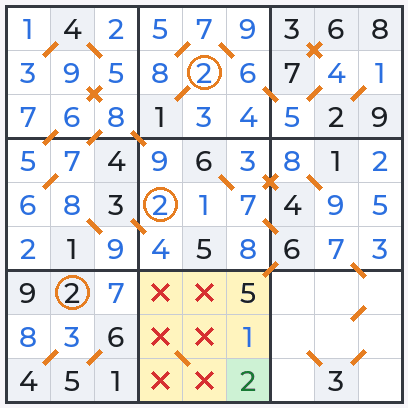

#### Step 44: the 3 in box 8

Box 8 needs a 3. r7c5: column 5 has one (r3c5). r8c4 and r8c5: row 8 has one (r8c2). r9c4 and r9c5: row 9 has one (r9c8). Only **r7c4** is left: **r7c4 = 3**.

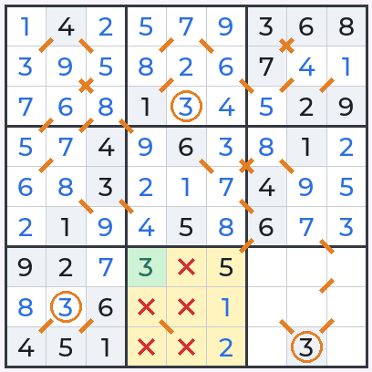

#### Step 45: the 4 in box 8

Box 8 needs a 4. r8c4: column 4 has one (r6c4). r9c4 and r9c5: row 9 has one (r9c1). r8c5: it touches the 3 in r7c4 at a corner with no mark between them, and 4 is 1 away from it. Only **r7c5** is left: **r7c5 = 4**.

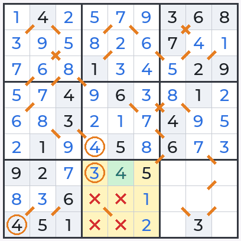

#### Step 46: the 6 in box 8

Box 8 needs a 6. r8c4 and r8c5: row 8 has one (r8c3). r9c5: column 5 has one (r4c5). Only **r9c4** is left: **r9c4 = 6**.

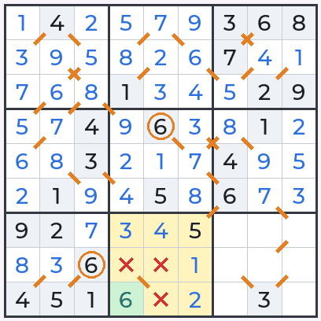

#### Step 47: the 7 in box 8

Box 8 needs a 7. r8c5 and r9c5: column 5 has one (r1c5). Only **r8c4** is left: **r8c4 = 7**.

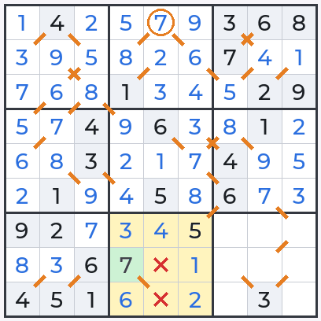

#### Step 48: the 8 in box 8

Box 8 needs an 8. r8c5: row 8 has one (r8c1). Only **r9c5** is left: **r9c5 = 8**.

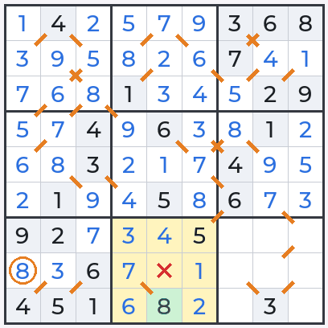

#### Step 49: the 9 in box 8

Box 8 needs a 9, and r8c5 is its last empty cell: **r8c5 = 9**.

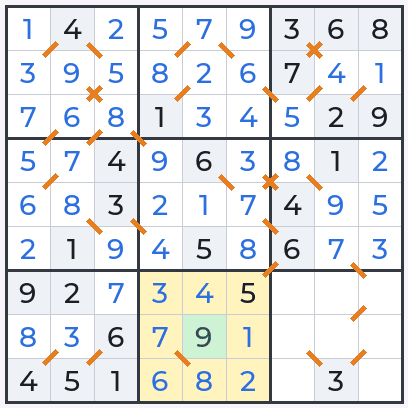

#### Step 50: the 1 in box 9

Box 9 needs a 1. r7c8: column 8 has one (r4c8). r7c9: column 9 has one (r2c9). r8c7, r8c8 and r8c9: row 8 has one (r8c6). r9c7 and r9c9: row 9 has one (r9c3). Only **r7c7** is left: **r7c7 = 1**.

#### Step 51: the 2 in box 9

Box 9 needs a 2. r7c8 and r7c9: row 7 has one (r7c2). r8c8: column 8 has one (r3c8). r8c9: column 9 has one (r4c9). r9c7 and r9c9: row 9 has one (r9c6). Only **r8c7** is left: **r8c7 = 2**.

#### Step 52: the 4 in box 9

Box 9 needs a 4. r7c8 and r7c9: row 7 has one (r7c5). r8c8: column 8 has one (r2c8). r9c7 and r9c9: row 9 has one (r9c1). Only **r8c9** is left: **r8c9 = 4**.

#### Step 53: the 5 in box 9

Box 9 needs a 5. r7c8 and r7c9: row 7 has one (r7c6). r9c7 and r9c9: row 9 has one (r9c2). Only **r8c8** is left: **r8c8 = 5**.

#### Step 54: the 6 in box 9

Box 9 needs a 6. r7c8: column 8 has one (r1c8). r9c7 and r9c9: row 9 has one (r9c4). Only **r7c9** is left: **r7c9 = 6**.

#### Step 55: the 7 in box 9

Box 9 needs a 7. r7c8: row 7 has one (r7c3). r9c7: column 7 has one (r2c7). Only **r9c9** is left: **r9c9 = 7**.

#### Step 56: the 8 in box 9

Box 9 needs an 8. r9c7: row 9 has one (r9c5). Only **r7c8** is left: **r7c8 = 8**.

#### Step 57: the 9 in box 9

Box 9 needs a 9, and r9c7 is its last empty cell: **r9c7 = 9**.

Solved.

<!-- /walkthrough -->
