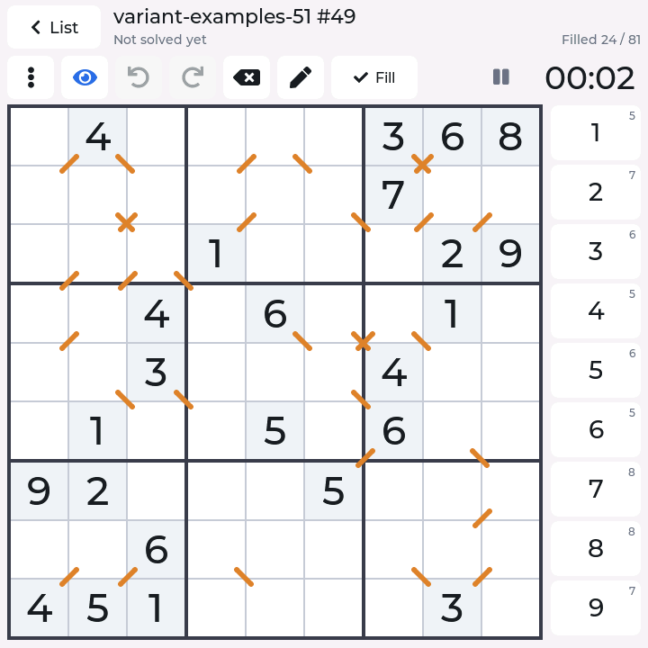

# Diagonal Consecutive

[← All variants](README.md) · [Puzzles](../features-puzzles.md) · [How to play](../how-to-play.md)

## The rules

[Classic](classic.md) rules, and **marks across corners**: where two cells touch at a corner and an orange bar joins them, their digits are **1 apart** (3 and 4). Where no bar joins two corner-touching cells, they are **not** 1 apart. Every such pair is marked, so the missing marks are clues too, as in [Diagonal Non-Consecutive](diagonal-non-consecutive.md), which is this variant with no marks at all.

## On the board

- A short orange bar crosses the corner, along the diagonal of the two cells it joins; where two bars cross at one corner, both pairs are 1 apart.
- Two corner neighbours that break the rule (marked and not 1 apart, or unmarked and 1 apart) turn red.
- The grader and hints take out what each corner neighbour rules out: "The cells touching row 2, column 1 at its corners are 1 apart from it where a mark joins them, and not where none does, which leaves it only 3, 5."
- **Puzzles → ⋮ → New puzzle → Marks → Diagonal C.** The marks say so much that a Medium or Expert puzzle keeps only a handful of givens.

## How to solve it

- **A mark leaves two digits:** marked to a 4, a cell is 3 or 5; marked to a 1 it's 2, to a 9 it's 8.
- **No mark rules out two:** unmarked next to a 4, a corner cell can't be 3 or 5.
- **Two marks from one digit:** a 4 marked to two cells in the same row (or column) makes them 3 and 5, one each: the rest of that row needs its 3 and 5 nowhere else.

## Worked example

**variant-examples #49**, Diagonal Consecutive Easy (see [Classic](classic.md#worked-example-the-whole-puzzle) for how to import the examples; cells are written r*row*c*column*). The 4 in r1c2 has a mark at both its bottom corners: r2c1 and r2c3 are each 3 or 5.

**Step 1: the 1 in box 1.** r1c3 and r2c3: column 3 has a 1 (r9c3). r2c2: column 2 has one (r6c2). Row 3 has one (r3c4). And r2c1 is marked to the 4, so it's 3 or 5. Only **r1c1** is left: **r1c1 = 1**.

**Step 2: the 2 in box 1.** r2c2: column 2 has a 2 (r7c2); row 3 has one (r3c8); r2c1 and r2c3 are both marked to the 4. Only **r1c3** is left: **r1c3 = 2**.

**Step 3: the 9 in box 1.** r2c1: column 1 has a 9 (r7c1); row 3 has one (r3c9); r2c3 is marked to the 4. Only **r2c2** is left: **r2c2 = 9**.

## The whole puzzle, step by step

<!-- walkthrough -->
<!-- Written by tools/walkthrough.py diagonal-consecutive: edit the script, not this part. -->

The whole puzzle, from the start to the last cell: 57 steps, each one a single (one place left for a digit, or one digit left for a cell), taken in the order a box's single comes first, so not quite the order of the worked example above. Each step has a page of its own, with **Previous** and **Next**: pick its number below. In each picture, the unit the step looks at is tinted yellow (for a cell with one digit left: its row, column and box), the new digit is on green, the digits that rule cells out have an **orange ring**, and the empty cells they rule out a **red cross**. Givens are on grey, digits from earlier steps in blue.

| [1](diagonal-consecutive/step-01.md) | [2](diagonal-consecutive/step-02.md) | [3](diagonal-consecutive/step-03.md) | [4](diagonal-consecutive/step-04.md) | [5](diagonal-consecutive/step-05.md) | [6](diagonal-consecutive/step-06.md) | [7](diagonal-consecutive/step-07.md) | [8](diagonal-consecutive/step-08.md) | [9](diagonal-consecutive/step-09.md) | [10](diagonal-consecutive/step-10.md) |
|:-:|:-:|:-:|:-:|:-:|:-:|:-:|:-:|:-:|:-:|
| [11](diagonal-consecutive/step-11.md) | [12](diagonal-consecutive/step-12.md) | [13](diagonal-consecutive/step-13.md) | [14](diagonal-consecutive/step-14.md) | [15](diagonal-consecutive/step-15.md) | [16](diagonal-consecutive/step-16.md) | [17](diagonal-consecutive/step-17.md) | [18](diagonal-consecutive/step-18.md) | [19](diagonal-consecutive/step-19.md) | [20](diagonal-consecutive/step-20.md) |
| [21](diagonal-consecutive/step-21.md) | [22](diagonal-consecutive/step-22.md) | [23](diagonal-consecutive/step-23.md) | [24](diagonal-consecutive/step-24.md) | [25](diagonal-consecutive/step-25.md) | [26](diagonal-consecutive/step-26.md) | [27](diagonal-consecutive/step-27.md) | [28](diagonal-consecutive/step-28.md) | [29](diagonal-consecutive/step-29.md) | [30](diagonal-consecutive/step-30.md) |
| [31](diagonal-consecutive/step-31.md) | [32](diagonal-consecutive/step-32.md) | [33](diagonal-consecutive/step-33.md) | [34](diagonal-consecutive/step-34.md) | [35](diagonal-consecutive/step-35.md) | [36](diagonal-consecutive/step-36.md) | [37](diagonal-consecutive/step-37.md) | [38](diagonal-consecutive/step-38.md) | [39](diagonal-consecutive/step-39.md) | [40](diagonal-consecutive/step-40.md) |
| [41](diagonal-consecutive/step-41.md) | [42](diagonal-consecutive/step-42.md) | [43](diagonal-consecutive/step-43.md) | [44](diagonal-consecutive/step-44.md) | [45](diagonal-consecutive/step-45.md) | [46](diagonal-consecutive/step-46.md) | [47](diagonal-consecutive/step-47.md) | [48](diagonal-consecutive/step-48.md) | [49](diagonal-consecutive/step-49.md) | [50](diagonal-consecutive/step-50.md) |
| [51](diagonal-consecutive/step-51.md) | [52](diagonal-consecutive/step-52.md) | [53](diagonal-consecutive/step-53.md) | [54](diagonal-consecutive/step-54.md) | [55](diagonal-consecutive/step-55.md) | [56](diagonal-consecutive/step-56.md) | [57](diagonal-consecutive/step-57.md) |  |  |  |

Solved.

<!-- /walkthrough -->
