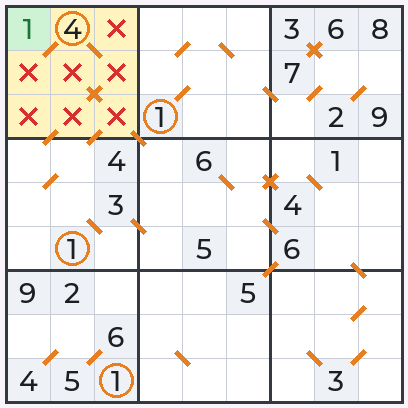

<!-- Written by tools/walkthrough.py diagonal-consecutive: edit the script, not this page. -->
# Diagonal Consecutive, step 1: the 1 in box 1

**Step 1 of 57** · [← The start](../diagonal-consecutive.md#the-whole-puzzle-step-by-step) · [All steps](../diagonal-consecutive.md#the-whole-puzzle-step-by-step) · [Step 2 →](step-02.md)

Box 1 needs a 1. r1c3 and r2c3: column 3 has one (r9c3). r2c2: column 2 has one (r6c2). r3c1, r3c2 and r3c3: row 3 has one (r3c4). r2c1: a mark joins it to the 4 in r1c2 at a corner, and 1 isn't 1 away from it. Only **r1c1** is left: **r1c1 = 1**.

**Step 1 of 57** · [← The start](../diagonal-consecutive.md#the-whole-puzzle-step-by-step) · [All steps](../diagonal-consecutive.md#the-whole-puzzle-step-by-step) · [Step 2 →](step-02.md)
