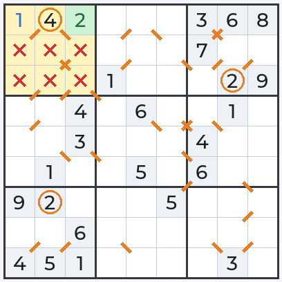

<!-- Written by tools/walkthrough.py diagonal-consecutive: edit the script, not this page. -->
# Diagonal Consecutive, step 2: the 2 in box 1

**Step 2 of 57** · [← Step 1](step-01.md) · [All steps](../diagonal-consecutive.md#the-whole-puzzle-step-by-step) · [Step 3 →](step-03.md)

Box 1 needs a 2. r2c2: column 2 has one (r7c2). r3c1, r3c2 and r3c3: row 3 has one (r3c8). r2c1 and r2c3: a mark joins it to the 4 in r1c2 at a corner, and 2 isn't 1 away from it. Only **r1c3** is left: **r1c3 = 2**.

**Step 2 of 57** · [← Step 1](step-01.md) · [All steps](../diagonal-consecutive.md#the-whole-puzzle-step-by-step) · [Step 3 →](step-03.md)
