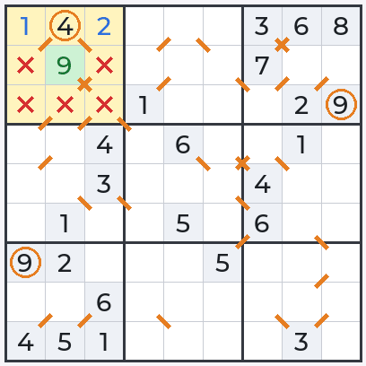

<!-- Written by tools/walkthrough.py diagonal-consecutive: edit the script, not this page. -->
# Diagonal Consecutive, step 3: the 9 in box 1

**Step 3 of 57** · [← Step 2](step-02.md) · [All steps](../diagonal-consecutive.md#the-whole-puzzle-step-by-step) · [Step 4 →](step-04.md)

Box 1 needs a 9. r2c1: column 1 has one (r7c1). r3c1, r3c2 and r3c3: row 3 has one (r3c9). r2c3: a mark joins it to the 4 in r1c2 at a corner, and 9 isn't 1 away from it. Only **r2c2** is left: **r2c2 = 9**.

**Step 3 of 57** · [← Step 2](step-02.md) · [All steps](../diagonal-consecutive.md#the-whole-puzzle-step-by-step) · [Step 4 →](step-04.md)
