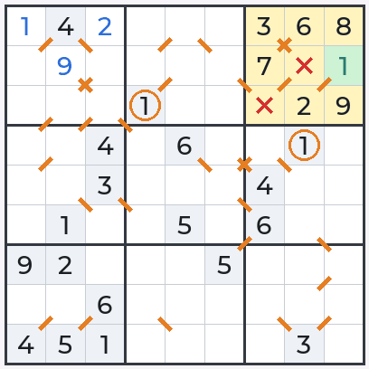

<!-- Written by tools/walkthrough.py diagonal-consecutive: edit the script, not this page. -->
# Diagonal Consecutive, step 4: the 1 in box 3

**Step 4 of 57** · [← Step 3](step-03.md) · [All steps](../diagonal-consecutive.md#the-whole-puzzle-step-by-step) · [Step 5 →](step-05.md)

Box 3 needs a 1. r2c8: column 8 has one (r4c8). r3c7: row 3 has one (r3c4). Only **r2c9** is left: **r2c9 = 1**.

**Step 4 of 57** · [← Step 3](step-03.md) · [All steps](../diagonal-consecutive.md#the-whole-puzzle-step-by-step) · [Step 5 →](step-05.md)
