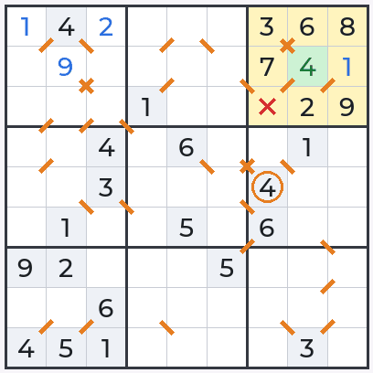

<!-- Written by tools/walkthrough.py diagonal-consecutive: edit the script, not this page. -->
# Diagonal Consecutive, step 5: the 4 in box 3

**Step 5 of 57** · [← Step 4](step-04.md) · [All steps](../diagonal-consecutive.md#the-whole-puzzle-step-by-step) · [Step 6 →](step-06.md)

Box 3 needs a 4. r3c7: column 7 has one (r5c7). Only **r2c8** is left: **r2c8 = 4**.

**Step 5 of 57** · [← Step 4](step-04.md) · [All steps](../diagonal-consecutive.md#the-whole-puzzle-step-by-step) · [Step 6 →](step-06.md)
