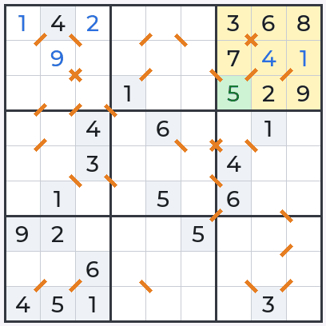

<!-- Written by tools/walkthrough.py diagonal-consecutive: edit the script, not this page. -->
# Diagonal Consecutive, step 6: the 5 in box 3

**Step 6 of 57** · [← Step 5](step-05.md) · [All steps](../diagonal-consecutive.md#the-whole-puzzle-step-by-step) · [Step 7 →](step-07.md)

Box 3 needs a 5, and r3c7 is its last empty cell: **r3c7 = 5**.

**Step 6 of 57** · [← Step 5](step-05.md) · [All steps](../diagonal-consecutive.md#the-whole-puzzle-step-by-step) · [Step 7 →](step-07.md)
