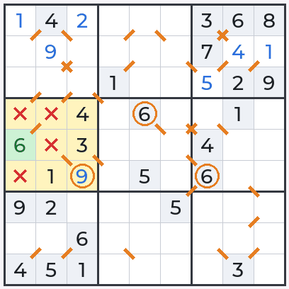

<!-- Written by tools/walkthrough.py diagonal-consecutive: edit the script, not this page. -->
# Diagonal Consecutive, step 8: the 6 in box 4

**Step 8 of 57** · [← Step 7](step-07.md) · [All steps](../diagonal-consecutive.md#the-whole-puzzle-step-by-step) · [Step 9 →](step-09.md)

Box 4 needs a 6. r4c1 and r4c2: row 4 has one (r4c5). r6c1: row 6 has one (r6c7). r5c2: a mark joins it to the 9 in r6c3 at a corner, and 6 isn't 1 away from it. Only **r5c1** is left: **r5c1 = 6**.

**Step 8 of 57** · [← Step 7](step-07.md) · [All steps](../diagonal-consecutive.md#the-whole-puzzle-step-by-step) · [Step 9 →](step-09.md)
