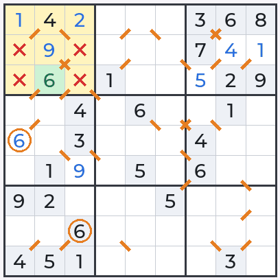

<!-- Written by tools/walkthrough.py diagonal-consecutive: edit the script, not this page. -->
# Diagonal Consecutive, step 9: the 6 in box 1

**Step 9 of 57** · [← Step 8](step-08.md) · [All steps](../diagonal-consecutive.md#the-whole-puzzle-step-by-step) · [Step 10 →](step-10.md)

Box 1 needs a 6. r2c1 and r3c1: column 1 has one (r5c1). r2c3 and r3c3: column 3 has one (r8c3). Only **r3c2** is left: **r3c2 = 6**.

**Step 9 of 57** · [← Step 8](step-08.md) · [All steps](../diagonal-consecutive.md#the-whole-puzzle-step-by-step) · [Step 10 →](step-10.md)
