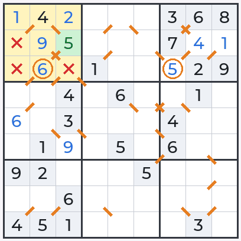

<!-- Written by tools/walkthrough.py diagonal-consecutive: edit the script, not this page. -->
# Diagonal Consecutive, step 10: the 5 in box 1

**Step 10 of 57** · [← Step 9](step-09.md) · [All steps](../diagonal-consecutive.md#the-whole-puzzle-step-by-step) · [Step 11 →](step-11.md)

Box 1 needs a 5. r3c1 and r3c3: row 3 has one (r3c7). r2c1: it touches the 6 in r3c2 at a corner with no mark between them, and 5 is 1 away from it. Only **r2c3** is left: **r2c3 = 5**.

**Step 10 of 57** · [← Step 9](step-09.md) · [All steps](../diagonal-consecutive.md#the-whole-puzzle-step-by-step) · [Step 11 →](step-11.md)
