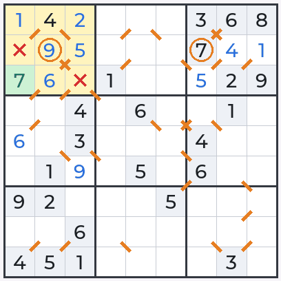

<!-- Written by tools/walkthrough.py diagonal-consecutive: edit the script, not this page. -->
# Diagonal Consecutive, step 11: the 7 in box 1

**Step 11 of 57** · [← Step 10](step-10.md) · [All steps](../diagonal-consecutive.md#the-whole-puzzle-step-by-step) · [Step 12 →](step-12.md)

Box 1 needs a 7. r2c1: row 2 has one (r2c7). r3c3: a mark joins it to the 9 in r2c2 at a corner, and 7 isn't 1 away from it. Only **r3c1** is left: **r3c1 = 7**.

**Step 11 of 57** · [← Step 10](step-10.md) · [All steps](../diagonal-consecutive.md#the-whole-puzzle-step-by-step) · [Step 12 →](step-12.md)
