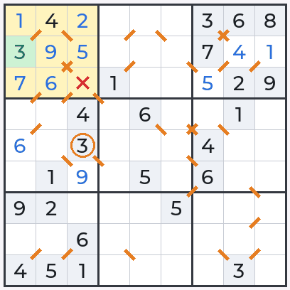

<!-- Written by tools/walkthrough.py diagonal-consecutive: edit the script, not this page. -->
# Diagonal Consecutive, step 12: the 3 in box 1

**Step 12 of 57** · [← Step 11](step-11.md) · [All steps](../diagonal-consecutive.md#the-whole-puzzle-step-by-step) · [Step 13 →](step-13.md)

Box 1 needs a 3. r3c3: column 3 has one (r5c3). Only **r2c1** is left: **r2c1 = 3**.

**Step 12 of 57** · [← Step 11](step-11.md) · [All steps](../diagonal-consecutive.md#the-whole-puzzle-step-by-step) · [Step 13 →](step-13.md)
