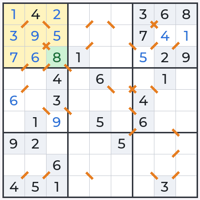

<!-- Written by tools/walkthrough.py diagonal-consecutive: edit the script, not this page. -->
# Diagonal Consecutive, step 13: the 8 in box 1

**Step 13 of 57** · [← Step 12](step-12.md) · [All steps](../diagonal-consecutive.md#the-whole-puzzle-step-by-step) · [Step 14 →](step-14.md)

Box 1 needs an 8, and r3c3 is its last empty cell: **r3c3 = 8**.

**Step 13 of 57** · [← Step 12](step-12.md) · [All steps](../diagonal-consecutive.md#the-whole-puzzle-step-by-step) · [Step 14 →](step-14.md)
