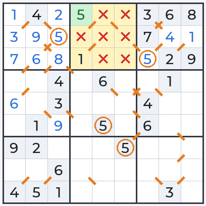

<!-- Written by tools/walkthrough.py diagonal-consecutive: edit the script, not this page. -->
# Diagonal Consecutive, step 14: the 5 in box 2

**Step 14 of 57** · [← Step 13](step-13.md) · [All steps](../diagonal-consecutive.md#the-whole-puzzle-step-by-step) · [Step 15 →](step-15.md)

Box 2 needs a 5. r1c5: column 5 has one (r6c5). r1c6: column 6 has one (r7c6). r2c4, r2c5 and r2c6: row 2 has one (r2c3). r3c5 and r3c6: row 3 has one (r3c7). Only **r1c4** is left: **r1c4 = 5**.

**Step 14 of 57** · [← Step 13](step-13.md) · [All steps](../diagonal-consecutive.md#the-whole-puzzle-step-by-step) · [Step 15 →](step-15.md)
