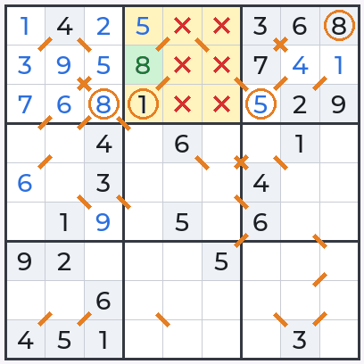

<!-- Written by tools/walkthrough.py diagonal-consecutive: edit the script, not this page. -->
# Diagonal Consecutive, step 15: the 8 in box 2

**Step 15 of 57** · [← Step 14](step-14.md) · [All steps](../diagonal-consecutive.md#the-whole-puzzle-step-by-step) · [Step 16 →](step-16.md)

Box 2 needs an 8. r1c5 and r1c6: row 1 has one (r1c9). r3c5 and r3c6: row 3 has one (r3c3). r2c5: a mark joins it to the 1 in r3c4 at a corner, and 8 isn't 1 away from it. r2c6: a mark joins it to the 5 in r3c7 at a corner, and 8 isn't 1 away from it. Only **r2c4** is left: **r2c4 = 8**.

**Step 15 of 57** · [← Step 14](step-14.md) · [All steps](../diagonal-consecutive.md#the-whole-puzzle-step-by-step) · [Step 16 →](step-16.md)
