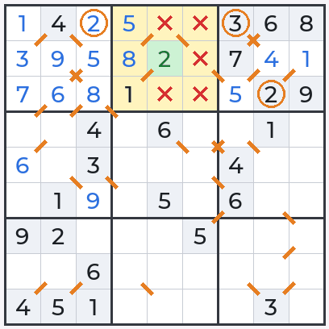

<!-- Written by tools/walkthrough.py diagonal-consecutive: edit the script, not this page. -->
# Diagonal Consecutive, step 16: the 2 in box 2

**Step 16 of 57** · [← Step 15](step-15.md) · [All steps](../diagonal-consecutive.md#the-whole-puzzle-step-by-step) · [Step 17 →](step-17.md)

Box 2 needs a 2. r1c5 and r1c6: row 1 has one (r1c3). r3c5 and r3c6: row 3 has one (r3c8). r2c6: it touches the 3 in r1c7 at a corner with no mark between them, and 2 is 1 away from it. Only **r2c5** is left: **r2c5 = 2**.

**Step 16 of 57** · [← Step 15](step-15.md) · [All steps](../diagonal-consecutive.md#the-whole-puzzle-step-by-step) · [Step 17 →](step-17.md)
