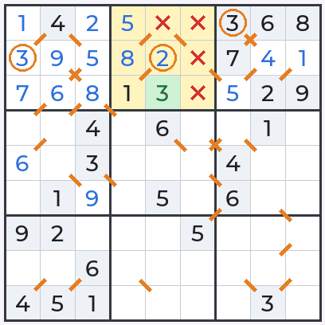

<!-- Written by tools/walkthrough.py diagonal-consecutive: edit the script, not this page. -->
# Diagonal Consecutive, step 17: the 3 in box 2

**Step 17 of 57** · [← Step 16](step-16.md) · [All steps](../diagonal-consecutive.md#the-whole-puzzle-step-by-step) · [Step 18 →](step-18.md)

Box 2 needs a 3. r1c5 and r1c6: row 1 has one (r1c7). r2c6: row 2 has one (r2c1). r3c6: it touches the 2 in r2c5 at a corner with no mark between them, and 3 is 1 away from it. Only **r3c5** is left: **r3c5 = 3**.

**Step 17 of 57** · [← Step 16](step-16.md) · [All steps](../diagonal-consecutive.md#the-whole-puzzle-step-by-step) · [Step 18 →](step-18.md)
