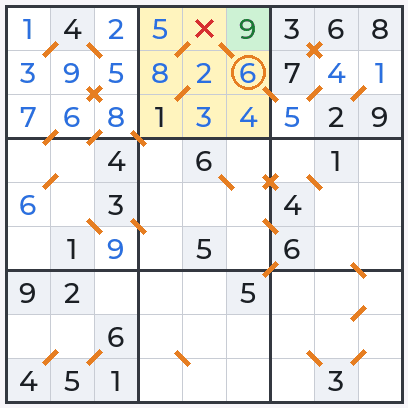

<!-- Written by tools/walkthrough.py diagonal-consecutive: edit the script, not this page. -->
# Diagonal Consecutive, step 20: the 9 in box 2

**Step 20 of 57** · [← Step 19](step-19.md) · [All steps](../diagonal-consecutive.md#the-whole-puzzle-step-by-step) · [Step 21 →](step-21.md)

Box 2 needs a 9. r1c5: a mark joins it to the 6 in r2c6 at a corner, and 9 isn't 1 away from it. Only **r1c6** is left: **r1c6 = 9**.

**Step 20 of 57** · [← Step 19](step-19.md) · [All steps](../diagonal-consecutive.md#the-whole-puzzle-step-by-step) · [Step 21 →](step-21.md)
