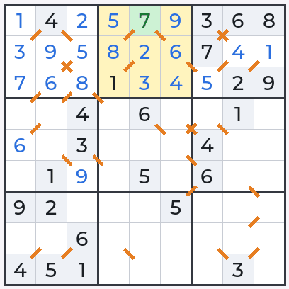

<!-- Written by tools/walkthrough.py diagonal-consecutive: edit the script, not this page. -->
# Diagonal Consecutive, step 21: the 7 in box 2

**Step 21 of 57** · [← Step 20](step-20.md) · [All steps](../diagonal-consecutive.md#the-whole-puzzle-step-by-step) · [Step 22 →](step-22.md)

Box 2 needs a 7, and r1c5 is its last empty cell: **r1c5 = 7**.

**Step 21 of 57** · [← Step 20](step-20.md) · [All steps](../diagonal-consecutive.md#the-whole-puzzle-step-by-step) · [Step 22 →](step-22.md)
