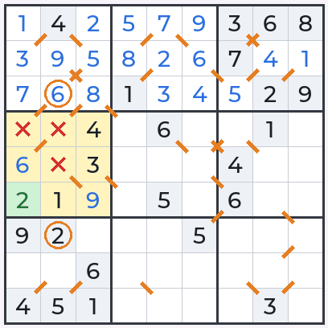

<!-- Written by tools/walkthrough.py diagonal-consecutive: edit the script, not this page. -->
# Diagonal Consecutive, step 22: the 2 in box 4

**Step 22 of 57** · [← Step 21](step-21.md) · [All steps](../diagonal-consecutive.md#the-whole-puzzle-step-by-step) · [Step 23 →](step-23.md)

Box 4 needs a 2. r4c2 and r5c2: column 2 has one (r7c2). r4c1: a mark joins it to the 6 in r3c2 at a corner, and 2 isn't 1 away from it. Only **r6c1** is left: **r6c1 = 2**.

**Step 22 of 57** · [← Step 21](step-21.md) · [All steps](../diagonal-consecutive.md#the-whole-puzzle-step-by-step) · [Step 23 →](step-23.md)
