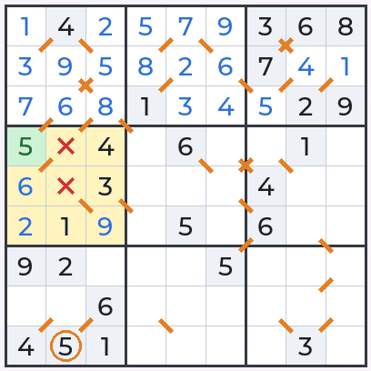

<!-- Written by tools/walkthrough.py diagonal-consecutive: edit the script, not this page. -->
# Diagonal Consecutive, step 23: the 5 in box 4

**Step 23 of 57** · [← Step 22](step-22.md) · [All steps](../diagonal-consecutive.md#the-whole-puzzle-step-by-step) · [Step 24 →](step-24.md)

Box 4 needs a 5. r4c2 and r5c2: column 2 has one (r9c2). Only **r4c1** is left: **r4c1 = 5**.

**Step 23 of 57** · [← Step 22](step-22.md) · [All steps](../diagonal-consecutive.md#the-whole-puzzle-step-by-step) · [Step 24 →](step-24.md)
