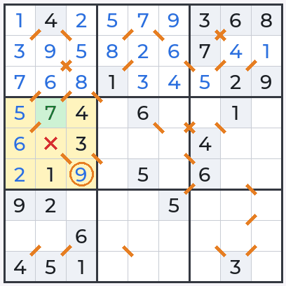

<!-- Written by tools/walkthrough.py diagonal-consecutive: edit the script, not this page. -->
# Diagonal Consecutive, step 24: the 7 in box 4

**Step 24 of 57** · [← Step 23](step-23.md) · [All steps](../diagonal-consecutive.md#the-whole-puzzle-step-by-step) · [Step 25 →](step-25.md)

Box 4 needs a 7. r5c2: a mark joins it to the 9 in r6c3 at a corner, and 7 isn't 1 away from it. Only **r4c2** is left: **r4c2 = 7**.

**Step 24 of 57** · [← Step 23](step-23.md) · [All steps](../diagonal-consecutive.md#the-whole-puzzle-step-by-step) · [Step 25 →](step-25.md)
