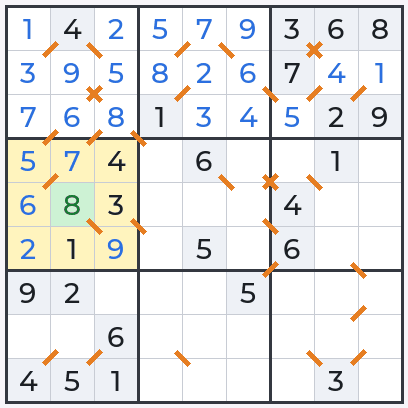

<!-- Written by tools/walkthrough.py diagonal-consecutive: edit the script, not this page. -->
# Diagonal Consecutive, step 25: the 8 in box 4

**Step 25 of 57** · [← Step 24](step-24.md) · [All steps](../diagonal-consecutive.md#the-whole-puzzle-step-by-step) · [Step 26 →](step-26.md)

Box 4 needs an 8, and r5c2 is its last empty cell: **r5c2 = 8**.

**Step 25 of 57** · [← Step 24](step-24.md) · [All steps](../diagonal-consecutive.md#the-whole-puzzle-step-by-step) · [Step 26 →](step-26.md)
