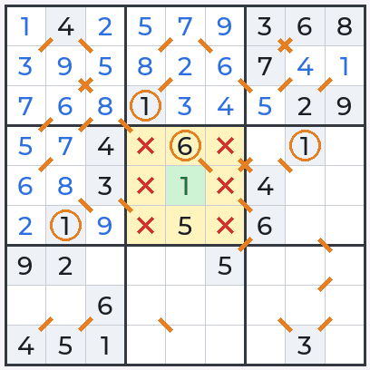

<!-- Written by tools/walkthrough.py diagonal-consecutive: edit the script, not this page. -->
# Diagonal Consecutive, step 26: the 1 in box 5

**Step 26 of 57** · [← Step 25](step-25.md) · [All steps](../diagonal-consecutive.md#the-whole-puzzle-step-by-step) · [Step 27 →](step-27.md)

Box 5 needs a 1. r4c4 and r4c6: row 4 has one (r4c8). r5c4: column 4 has one (r3c4). r6c4 and r6c6: row 6 has one (r6c2). r5c6: a mark joins it to the 6 in r4c5 at a corner, and 1 isn't 1 away from it. Only **r5c5** is left: **r5c5 = 1**.

**Step 26 of 57** · [← Step 25](step-25.md) · [All steps](../diagonal-consecutive.md#the-whole-puzzle-step-by-step) · [Step 27 →](step-27.md)
