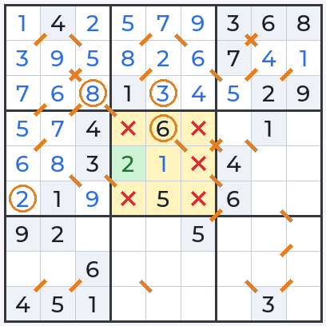

<!-- Written by tools/walkthrough.py diagonal-consecutive: edit the script, not this page. -->
# Diagonal Consecutive, step 27: the 2 in box 5

**Step 27 of 57** · [← Step 26](step-26.md) · [All steps](../diagonal-consecutive.md#the-whole-puzzle-step-by-step) · [Step 28 →](step-28.md)

Box 5 needs a 2. r6c4 and r6c6: row 6 has one (r6c1). r4c4: a mark joins it to the 8 in r3c3 at a corner, and 2 isn't 1 away from it. r4c6: it touches the 3 in r3c5 at a corner with no mark between them, and 2 is 1 away from it. r5c6: a mark joins it to the 6 in r4c5 at a corner, and 2 isn't 1 away from it. Only **r5c4** is left: **r5c4 = 2**.

**Step 27 of 57** · [← Step 26](step-26.md) · [All steps](../diagonal-consecutive.md#the-whole-puzzle-step-by-step) · [Step 28 →](step-28.md)
