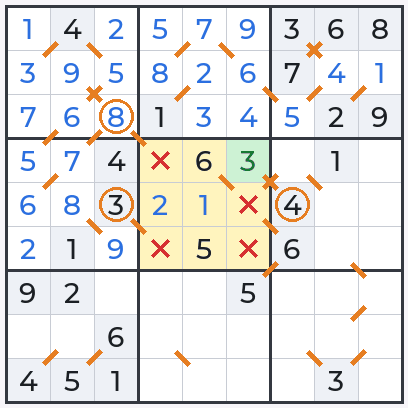

<!-- Written by tools/walkthrough.py diagonal-consecutive: edit the script, not this page. -->
# Diagonal Consecutive, step 28: the 3 in box 5

**Step 28 of 57** · [← Step 27](step-27.md) · [All steps](../diagonal-consecutive.md#the-whole-puzzle-step-by-step) · [Step 29 →](step-29.md)

Box 5 needs a 3. r5c6: row 5 has one (r5c3). r4c4: a mark joins it to the 8 in r3c3 at a corner, and 3 isn't 1 away from it. r6c4: a mark joins it to the 3 in r5c3 at a corner, and 3 isn't 1 away from it. r6c6: it touches the 4 in r5c7 at a corner with no mark between them, and 3 is 1 away from it. Only **r4c6** is left: **r4c6 = 3**.

**Step 28 of 57** · [← Step 27](step-27.md) · [All steps](../diagonal-consecutive.md#the-whole-puzzle-step-by-step) · [Step 29 →](step-29.md)
