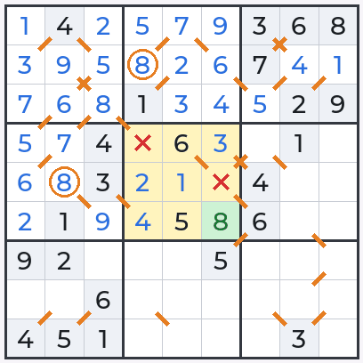

<!-- Written by tools/walkthrough.py diagonal-consecutive: edit the script, not this page. -->
# Diagonal Consecutive, step 30: the 8 in box 5

**Step 30 of 57** · [← Step 29](step-29.md) · [All steps](../diagonal-consecutive.md#the-whole-puzzle-step-by-step) · [Step 31 →](step-31.md)

Box 5 needs an 8. r4c4: column 4 has one (r2c4). r5c6: row 5 has one (r5c2). Only **r6c6** is left: **r6c6 = 8**.

**Step 30 of 57** · [← Step 29](step-29.md) · [All steps](../diagonal-consecutive.md#the-whole-puzzle-step-by-step) · [Step 31 →](step-31.md)
