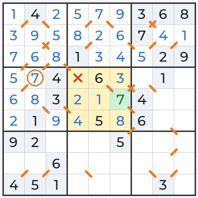

<!-- Written by tools/walkthrough.py diagonal-consecutive: edit the script, not this page. -->
# Diagonal Consecutive, step 31: the 7 in box 5

**Step 31 of 57** · [← Step 30](step-30.md) · [All steps](../diagonal-consecutive.md#the-whole-puzzle-step-by-step) · [Step 32 →](step-32.md)

Box 5 needs a 7. r4c4: row 4 has one (r4c2). Only **r5c6** is left: **r5c6 = 7**.

**Step 31 of 57** · [← Step 30](step-30.md) · [All steps](../diagonal-consecutive.md#the-whole-puzzle-step-by-step) · [Step 32 →](step-32.md)
