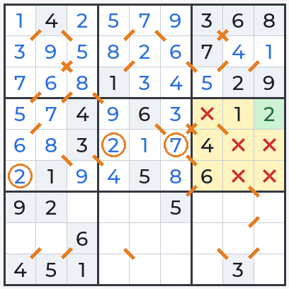

<!-- Written by tools/walkthrough.py diagonal-consecutive: edit the script, not this page. -->
# Diagonal Consecutive, step 33: the 2 in box 6

**Step 33 of 57** · [← Step 32](step-32.md) · [All steps](../diagonal-consecutive.md#the-whole-puzzle-step-by-step) · [Step 34 →](step-34.md)

Box 6 needs a 2. r5c8 and r5c9: row 5 has one (r5c4). r6c8 and r6c9: row 6 has one (r6c1). r4c7: a mark joins it to the 7 in r5c6 at a corner, and 2 isn't 1 away from it. Only **r4c9** is left: **r4c9 = 2**.

**Step 33 of 57** · [← Step 32](step-32.md) · [All steps](../diagonal-consecutive.md#the-whole-puzzle-step-by-step) · [Step 34 →](step-34.md)
