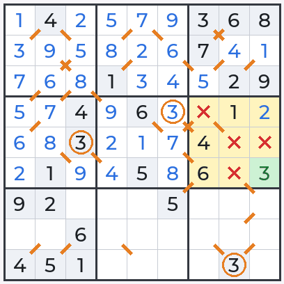

<!-- Written by tools/walkthrough.py diagonal-consecutive: edit the script, not this page. -->
# Diagonal Consecutive, step 34: the 3 in box 6

**Step 34 of 57** · [← Step 33](step-33.md) · [All steps](../diagonal-consecutive.md#the-whole-puzzle-step-by-step) · [Step 35 →](step-35.md)

Box 6 needs a 3. r4c7: row 4 has one (r4c6). r5c8 and r5c9: row 5 has one (r5c3). r6c8: column 8 has one (r9c8). Only **r6c9** is left: **r6c9 = 3**.

**Step 34 of 57** · [← Step 33](step-33.md) · [All steps](../diagonal-consecutive.md#the-whole-puzzle-step-by-step) · [Step 35 →](step-35.md)
